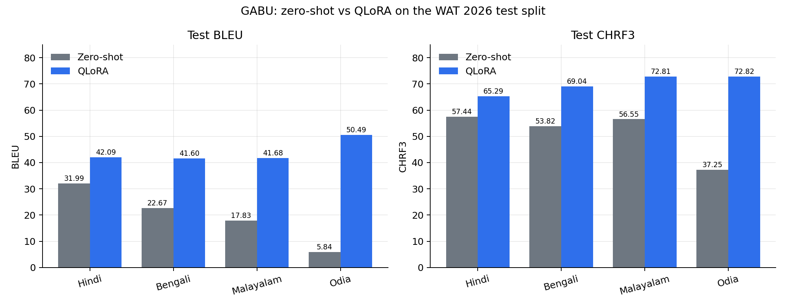

<div align="center">

# GABU @ WAT 2026

**Zero-Shot and QLoRA Adaptation of Gemma 4 E4B for Multimodal English→Indic Translation**

[](paper/2026.wat-1.10.pdf)
[](pyproject.toml)
[](LICENSE)
[](https://github.com/praaajg/gabu-wat2026/actions/workflows/ci.yml)
[](#languages)

</div>

This repository contains the paper, reference code, prompts, preprocessing
utilities, evaluation scripts, and machine-readable results for **GABU**, our
English-to-Indic multimodal machine translation system at the
[13th Workshop on Asian Translation (WAT 2026)](https://ufal.mff.cuni.cz/wat2026english-indicmultimodaltranslation).

The system adapts the instruction-tuned vision-language model
`google/gemma-4-E4B-it` with QLoRA and translates image-grounded English
captions into **Hindi, Bengali, Malayalam, and Odia** in a single joint adapter.

| Highlight | Value |
|---|---|
| Test macro BLEU | **19.58 → 43.97** (+24.39) |
| Test macro CHRF3 | **51.27 → 69.99** (+18.72) |
| Challenge macro BLEU | **23.67 → 40.37** (+16.70) |
| Challenge macro CHRF3 | **56.35 → 68.25** (+11.90) |
| Largest test gain | Odia: **+44.65 BLEU**, **+35.57 CHRF3** |
| Trainable adapter parameters | 139,526,144 (**1.73%** of 8.08B) |
| Compute | 3,000 steps on **2× NVIDIA T4** |

## Languages

| Code | Language | Script | Test rows | Challenge rows |
|---|---|---|---:|---:|
| `hi` | Hindi | Devanagari | 1,595 | 1,400 |
| `bn` | Bengali | Bengali | 1,595 | 1,400 |
| `ml` | Malayalam | Malayalam | 1,595 | 1,400 |
| `or` | Odia | Odia | 1,595 | — (no reference text released) |

## Task and method

The WAT English-to-Indic multimodal track provides an image, an annotated
rectangular region, and an English caption describing that region. Unlike
whole-image translation, the model must use **localized** visual context.

- **Region preprocessing.** Each box is expanded by 15% contextual padding
  (clamped to image bounds; degenerate boxes fall back to the full image),
  cropped, converted to RGB, and resized to a thumbnail capped at 448×448
  while preserving aspect ratio.
- **Coordinates.** The padded box is normalized to a 0–1000 scale and inserted
  into the prompt as `[x1, y1, x2, y2]`.
- **Prompt.** A single chat template with an expert-translator system
  instruction, the region image, and a user turn containing coordinates, the
  English caption, and a target-script cue. The model must output exactly one
  line in the target script, with no explanation, quotes, English, or
  romanization.
- **Backbone.** `google/gemma-4-E4B-it` loaded in 4-bit NF4 with double
  quantization, FP16 compute, and scaled dot-product attention.
- **Adapter.** LoRA rank 64, alpha 128, dropout 0.05, targeting `q, k, v, o,
  gate, up, down` projections. The base weights are frozen; 139.5M parameters
  are trainable (1.73%).
- **Training.** One adapter over all four languages (115,715 train + 3,992 dev
  rows). 8-bit AdamW, learning rate `1e-4`, cosine schedule with 5% warmup,
  effective batch size 16 (2 GPUs × 1 × gradient accumulation 8), max sequence
  length 1,024, seed 3407, 3,000 steps under a compute budget, gradient
  checkpointing.
- **Decoding.** Greedy, at most 32 new tokens; special tokens skipped and
  whitespace collapsed to a single line.

## Results

### Test split

| Language | BLEU (zero-shot) | BLEU (fine-tuned) | Δ BLEU | CHRF3 (zero-shot) | CHRF3 (fine-tuned) | Δ CHRF3 |
|---|---:|---:|---:|---:|---:|---:|
| Hindi | 31.99 | 42.09 | +10.10 | 57.44 | 65.29 | +7.85 |
| Bengali | 22.67 | 41.60 | +18.93 | 53.82 | 69.04 | +15.22 |
| Malayalam | 17.83 | 41.68 | +23.85 | 56.55 | 72.81 | +16.26 |
| Odia | 5.84 | 50.49 | +44.65 | 37.25 | 72.82 | +35.57 |
| **Macro** | **19.58** | **43.97** | **+24.39** | **51.27** | **69.99** | **+18.72** |

### Challenge split

| Language | BLEU (zero-shot) | BLEU (fine-tuned) | Δ BLEU | CHRF3 (zero-shot) | CHRF3 (fine-tuned) | Δ CHRF3 |
|---|---:|---:|---:|---:|---:|---:|
| Hindi | 36.51 | 50.58 | +14.07 | 61.10 | 69.68 | +8.58 |
| Bengali | 17.61 | 38.08 | +20.47 | 54.36 | 68.46 | +14.10 |
| Malayalam | 16.89 | 32.44 | +15.55 | 53.59 | 66.62 | +13.03 |
| **Macro** | **23.67** | **40.37** | **+16.70** | **56.35** | **68.25** | **+11.90** |

Odia challenge scoring is skipped because no challenge reference text was
released. The fine-tuned system improves on **every language and split**, with
the largest gains where the zero-shot model could barely produce the target
script (Odia test: 5.84 → 50.49 BLEU).



### Development trajectory

| Step | Macro BLEU | Macro CHRF3 |
|---:|---:|---:|
| 500 | 43.70 | 67.20 |
| 1,000 | 45.82 | 69.31 |
| 1,500 | 41.70 | 65.43 |
| 2,000 | 45.74 | 69.09 |
| 2,500 | 41.67 | 67.03 |
| 3,000 | **49.76** | **71.59** |

The step-3,000 checkpoint was selected as `best_adapter` by macro CHRF3. The
trajectory is non-monotonic; this is development-set generation scoring, not
the held-out test result. See [`docs/results.md`](docs/results.md).

## Quick start

```bash
git clone https://github.com/praaajg/gabu-wat2026.git
cd gabu-wat2026
python -m venv .venv
source .venv/bin/activate          # Windows: .venv\Scripts\activate
pip install -e ".[dev]"            # metrics + tests
pip install -e ".[train]"          # GPU training/inference stack
```

### 1. Prepare the data

Download the Visual Genome-derived Hindi, Bengali, Malayalam, and Odia
releases, then arrange one CSV per language and split:

```text
data/
├── train/{hi,bn,ml,or}.csv
├── dev/{hi,bn,ml,or}.csv
├── test/{hi,bn,ml,or}.csv
└── challenge/{hi,bn,ml}.csv
```

Each CSV needs an image path or base64 image, a bounding box, an English
caption, and (for train/dev/test) the target caption. Column names are
configurable in [`configs/qlora.yaml`](configs/qlora.yaml). Validate the layout:

```bash
python scripts/validate_data.py --data-dir data
```

### 2. Train the joint four-language adapter

```bash
gabu-train --config configs/qlora.yaml --data-dir data
```

### 3. Generate translations

```bash
gabu-infer \
  --config configs/qlora.yaml \
  --lang hi \
  --split test \
  --adapter outputs/gabu-gemma4-e4b-qlora/best_adapter \
  --output-dir outputs/test_predictions
```

This writes resumable `{lang}.jsonl` (`idx`, `ref`, `decoded`) and `{lang}.txt`
files, matching the evaluation format described in the paper.

### 4. Evaluate

```bash
gabu-evaluate \
  --pred-dir outputs/test_predictions \
  --languages hi bn ml or \
  --output outputs/test_metrics.json
```

Scores are corpus BLEU (13a tokenization, case-sensitive, single reference)
and CHRF3 (β=3, character order 6, word-bigram statistics), reported per
language and as an unweighted macro mean.

### 5. Merge the adapter (optional)

```bash
gabu-merge \
  --base google/gemma-4-E4B-it \
  --adapter outputs/gabu-gemma4-e4b-qlora/best_adapter \
  --output outputs/gabu-merged
```

> **Implementation status.** The paper describes a Hub-hosted adapter and a
> step-3,000 `best_adapter`, but does not provide a public code or adapter URL.
> This repository is a reference implementation reconstructed from the paper's
> protocol. It is not the authors' original training code. The evaluated
> adapter was the recorded step-3,000 checkpoint, not a pinned Hub revision.

## Repository layout

```text
gabu-wat2026/
├── assets/                   # README figures (generated)
├── configs/
│   └── qlora.yaml            # full training / inference configuration
├── docs/
│   ├── architecture.md       # pipeline and module map
│   ├── reproducibility.md    # data schema, commands, hyperparameters
│   └── results.md            # all paper tables and error analysis
├── paper/
│   ├── 2026.wat-1.10.pdf     # camera-ready paper
│   └── wat2026-gabu.bib
├── results/                  # machine-readable paper results
├── scripts/
│   ├── make_figures.py       # regenerate README figures
│   └── validate_data.py      # check the expected CSV layout
├── src/gabu/
│   ├── data.py               # language/split loading and image resolution
│   ├── evaluate.py           # BLEU / CHRF3 and macro aggregation
│   ├── infer.py              # resumable multilingual inference
│   ├── merge_adapter.py      # merge LoRA weights into the base model
│   ├── metrics.py            # sacrebleu wrappers
│   ├── model.py              # 4-bit loading + LoRA configuration
│   ├── preprocess.py         # 15% padding, crop, resize, coordinates
│   ├── prompt.py             # target-language prompt contract
│   └── train.py              # joint four-language HF Trainer pipeline
└── tests/                    # fast, CPU-only unit tests
```

## Data sources

- [Hindi Visual Genome](https://lindat.mff.cuni.cz/repository/xmlui/handle/11234/1-2998)
  (Parida et al., 2019)
- [Bengali Visual Genome](https://doi.org/10.1007/978-981-19-2347-0_6) (Sen et al., 2022)
- [Malayalam Visual Genome 1.0](https://lindat.mff.cuni.cz/repository/xmlui/handle/11234/1-3146)
  (Parida and Bojar, 2021)
- Odia Visual Genome (Parida et al., 2025)
- WAT 2026 English-to-Indic multimodal task:
  <https://ufal.mff.cuni.cz/wat2026english-indicmultimodaltranslation>

Dataset statistics from the paper:

| Language | Train | Dev | Test | Challenge |
|---|---:|---:|---:|---:|
| Hindi | 28,930 | 998 | 1,595 | 1,400 |
| Bengali | 28,930 | 998 | 1,595 | 1,400 |
| Malayalam | 28,930 | 998 | 1,595 | 1,400 |
| Odia | 28,930 | 998 | 1,595 | — |

## Citation

```bibtex
@inproceedings{saud2026gabu,
  title     = {{GABU}@{WAT} 2026: Zero Shot and {QLoRA} Adaptation of {Gemma} 4
               {E4B} for Multimodal {English} to {Indic} Translation},
  author    = {Saud, Shiv Ram and Mahato, Aashish and Ghimire, Prajwal and
               Dawadi, Sundeep and Saud, Ramesh and Regmi, Sunil},
  booktitle = {Proceedings of the 13th Workshop on Asian Translation (WAT 2026)},
  pages     = {145--154},
  year      = {2026},
  month     = nov,
  publisher = {Association for Computational Linguistics}
}
```

A `CITATION.cff` is provided for GitHub's citation widget.

## License

Code and documentation are released under the [MIT License](LICENSE). The
paper PDF is © 2026 the Authors and the Association for Computational
Linguistics; it is included for archival convenience. Datasets and model
weights retain their original licenses.

## Acknowledgements

We thank the WAT 2026 organizers and the creators and annotators of the Hindi,
Bengali, Malayalam, and Odia Visual Genome datasets.
