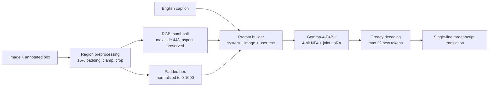
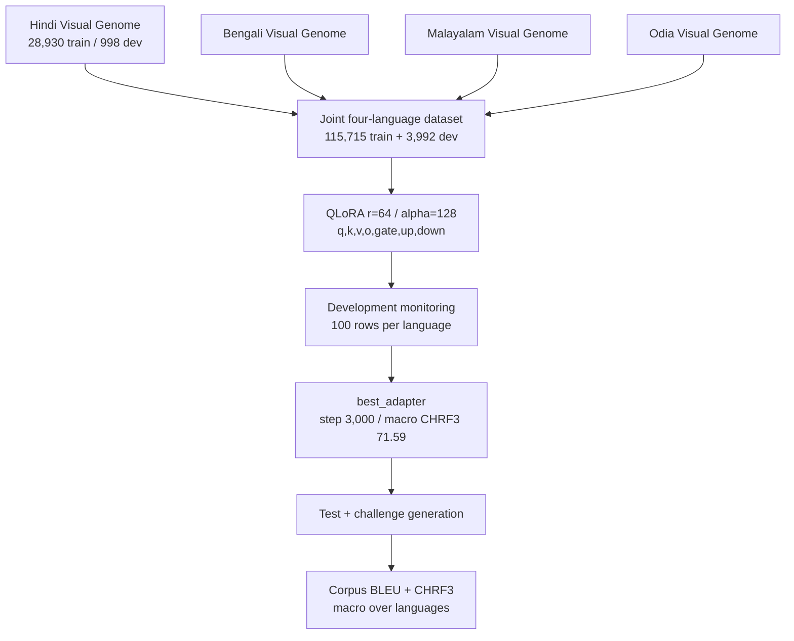

# Architecture

## Inference pipeline

One adapter serves all four languages. The target language and script are named
explicitly in the prompt; no language-specific adapter or decoder is used.

## Training pipeline

The paper trained a single adapter jointly over all four languages and selected
the step-3,000 checkpoint as `best_adapter` by development macro CHRF3.

## Module map

| Module | Responsibility |
|---|---|
| `gabu.prompt` | Language/script registry, system instruction, user turn, message builder. |
| `gabu.preprocess` | 15% padding, clamping, crop, aspect-preserving thumbnail, 0–1000 coordinates. |
| `gabu.data` | Per-language CSV loading, joint dataset, image resolution, monitor subset. |
| `gabu.model` | 4-bit NF4 loading, LoRA configuration, adapter attachment and merge. |
| `gabu.train` | Joint `transformers.Trainer` pipeline, prompt masking, collator. |
| `gabu.infer` | Resumable JSONL/text generation per language and split. |
| `gabu.merge_adapter` | Merge LoRA weights and save a standalone model. |
| `gabu.metrics` | Corpus BLEU (13a, case-sensitive) and CHRF3 (β=3, char 6, word 2). |
| `gabu.evaluate` | Per-language scores and unweighted macro aggregation. |

## Design notes

- **Localized visual context.** Captions are attached to rectangular regions,
  not whole images. The model receives only the padded crop plus normalized
  coordinates; there is no object detector or learned grounding module.
- **Aspect ratio is preserved.** The crop is resized with a thumbnail cap at
  448×448. Unlike the AstroCLIMB system, the image is not forced to a square.
- **Script constraint.** The prompt requires exactly one line in the named
  target script and forbids explanations, quotes, English, and romanization.
  This matters most for Odia, where the zero-shot model often failed to produce
  the script at all.
- **Joint multilingual adaptation.** One rank-64 adapter (139.5M parameters,
  1.73% of 8.08B) is trained across Hindi, Bengali, Malayalam, and Odia. The
  paper does not compare per-language adapters.
- **Uneven gains.** Odia gains the most on test (+44.65 BLEU, +35.57 CHRF3),
  Hindi the least (+10.10 BLEU, +7.85 CHRF3), starting from a much stronger
  zero-shot baseline. The paper presents these as observed patterns, not
  causal explanations.
- **No visual ablation.** The released results contain no text-only, image
  mismatch, or full-image versus region ablations. The contribution of visual
  information itself cannot be isolated from the evaluation.
- **Odia challenge.** No challenge reference text was released, so challenge
  scoring covers Hindi, Bengali, and Malayalam only.
