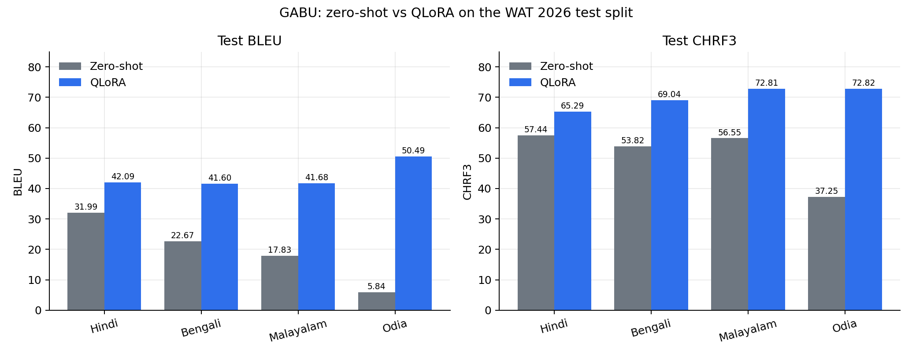
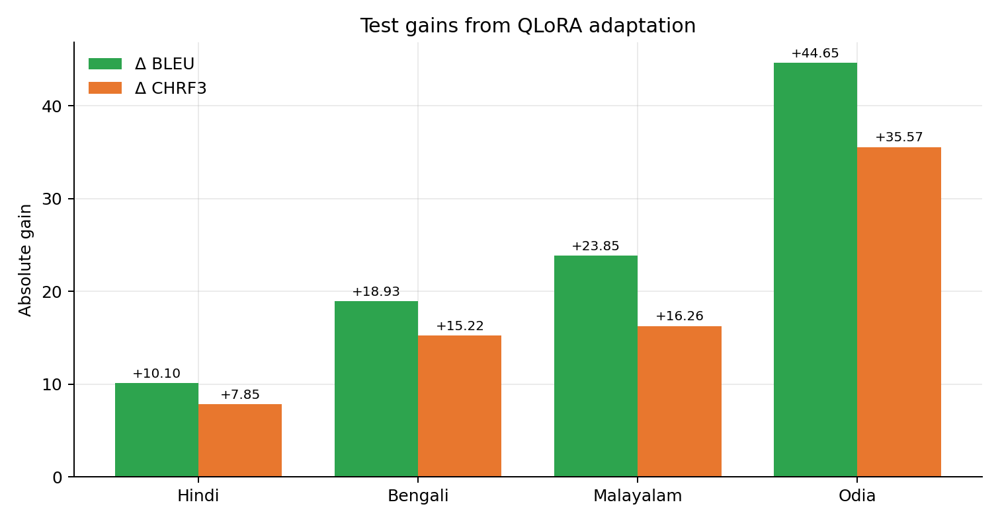
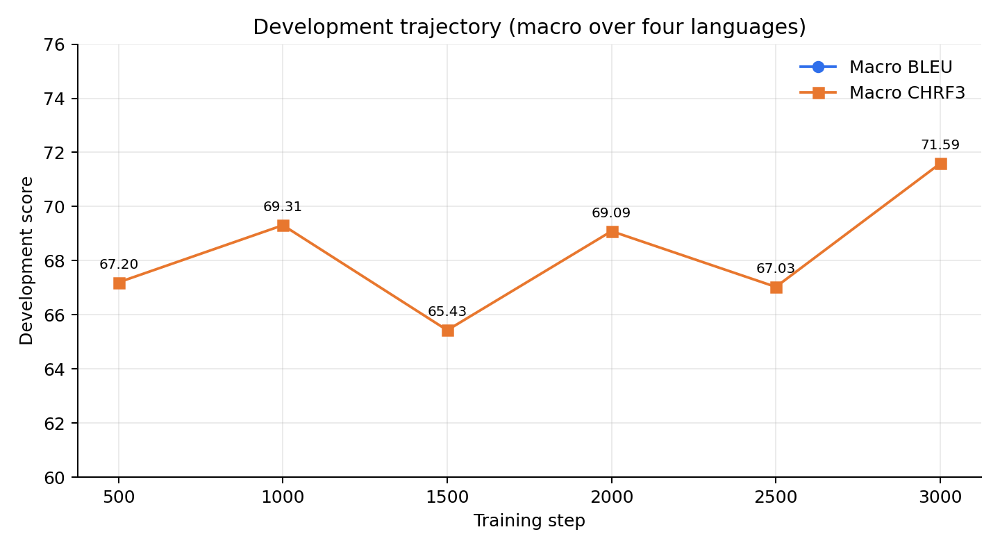

# Results

All numbers below are copied from the paper. Machine-readable versions live in
[`../results/`](../results) and are regenerated by
`python scripts/make_figures.py`.

## Headline

| Split | Metric | Zero-shot | QLoRA | Gain |
|---|---|---:|---:|---:|
| Test | BLEU (macro) | 19.58 | **43.97** | **+24.39** |
| Test | CHRF3 (macro) | 51.27 | **69.99** | **+18.72** |
| Challenge | BLEU (macro) | 23.67 | **40.37** | **+16.70** |
| Challenge | CHRF3 (macro) | 56.35 | **68.25** | **+11.90** |

## Test split

| Language | BLEU (zero-shot) | BLEU (fine-tuned) | Δ BLEU | CHRF3 (zero-shot) | CHRF3 (fine-tuned) | Δ CHRF3 |
|---|---:|---:|---:|---:|---:|---:|
| Hindi | 31.99 | 42.09 | +10.10 | 57.44 | 65.29 | +7.85 |
| Bengali | 22.67 | 41.60 | +18.93 | 53.82 | 69.04 | +15.22 |
| Malayalam | 17.83 | 41.68 | +23.85 | 56.55 | 72.81 | +16.26 |
| Odia | 5.84 | 50.49 | +44.65 | 37.25 | 72.82 | +35.57 |
| **Macro** | **19.58** | **43.97** | **+24.39** | **51.27** | **69.99** | **+18.72** |

### Error analysis

- The adapted system improves over zero-shot on **every language and split**.
- **Odia** has the largest absolute test gain (+44.65 BLEU, +35.57 CHRF3),
  starting from the weakest zero-shot baseline (5.84 BLEU / 37.25 CHRF3). The
  base model could often barely produce the target script.
- **Hindi** has the smallest test BLEU gain (+10.10), starting from the
  strongest zero-shot baseline (31.99 BLEU).
- Bengali (+18.93 BLEU) and Malayalam (+23.85 BLEU) fall in between.
- On CHRF3 the same ordering holds: Odia +35.57, Malayalam +16.26, Bengali
  +15.22, Hindi +7.85.
- These are observed patterns, not a causal explanation. The paper does not
  isolate visual grounding, script familiarity, or data effects.

## Challenge split

| Language | BLEU (zero-shot) | BLEU (fine-tuned) | Δ BLEU | CHRF3 (zero-shot) | CHRF3 (fine-tuned) | Δ CHRF3 |
|---|---:|---:|---:|---:|---:|---:|
| Hindi | 36.51 | 50.58 | +14.07 | 61.10 | 69.68 | +8.58 |
| Bengali | 17.61 | 38.08 | +20.47 | 54.36 | 68.46 | +14.10 |
| Malayalam | 16.89 | 32.44 | +15.55 | 53.59 | 66.62 | +13.03 |
| **Macro** | **23.67** | **40.37** | **+16.70** | **56.35** | **68.25** | **+11.90** |

Odia challenge scoring is skipped because no reference text was released.
Hindi reaches the best challenge scores in this evaluation (50.58 BLEU / 69.68
CHRF3).

## Development trajectory

The paper reports development generation scores every 500 steps. The trajectory
is non-monotonic; the step-3,000 checkpoint was selected as `best_adapter` by
macro CHRF3 (71.59).

| Step | Macro BLEU | Macro CHRF3 | Hindi (BLEU/CHRF3) | Bengali (BLEU/CHRF3) | Malayalam (BLEU/CHRF3) | Odia (BLEU/CHRF3) |
|---:|---:|---:|---:|---:|---:|---:|
| 500 | 43.70 | 67.20 | 36.01 / 59.23 | 36.81 / 66.88 | 49.04 / 73.38 | 52.95 / 69.29 |
| 1,000 | 45.82 | 69.31 | 34.14 / 59.31 | 43.84 / 70.65 | 48.04 / 74.41 | 57.25 / 72.87 |
| 1,500 | 41.70 | 65.43 | 33.60 / 58.14 | 45.02 / 68.44 | 32.73 / 63.70 | 55.47 / 71.44 |
| 2,000 | 45.74 | 69.09 | 34.49 / 58.93 | 43.33 / 72.99 | 50.99 / 70.60 | 54.16 / 73.86 |
| 2,500 | 41.67 | 67.03 | 39.29 / 61.54 | 42.39 / 74.40 | 32.09 / 60.29 | 52.90 / 71.88 |
| 3,000 | **49.76** | **71.59** | 37.78 / 59.79 | 49.04 / 75.36 | 48.75 / 72.73 | 63.47 / 78.49 |

## Baseline versus fine-tuned

| Property | Zero-shot baseline | Fine-tuned system |
|---|---|---|
| Model | Gemma 4 E4B-it, NF4, no adapter | Same base + LoRA r64/α128 (139.5M, 1.73%) |
| Training data | None (evaluation only) | 115,715 train + 3,992 dev, joint four languages |
| Training | — | 3,000 steps, effective batch 16, LR 1e-4 cosine |
| Prompt | Shared template, greedy 32 tokens | Byte-identical template and decoding |
| Test macro | 19.58 BLEU / 51.27 CHRF3 | **43.97 BLEU / 69.99 CHRF3** |
| Challenge macro | 23.67 BLEU / 56.35 CHRF3 | **40.37 BLEU / 68.25 CHRF3** |

## Evaluation protocol

- Test: 1,595 rows per language × 4 languages.
- Challenge: 1,400 rows × 3 languages (Hindi, Bengali, Malayalam).
- One reference per row.
- BLEU: 13a tokenization, case-sensitive, single reference.
- CHRF3: β=3, character order 6, word-bigram statistics.
- Scores rounded to two decimals; macro is the unweighted mean over evaluated
  languages.
- Development monitoring used a 400-row loss subset and a 200-row generation
  subset (100/50 rows per language respectively).

## Limitations

- Single rank-64 adapter; no full fine-tuning comparison.
- 3,000-step budget was chosen under compute constraints, not tuned for
  optimality.
- No dedicated fusion architecture or architectural ablations.
- No text-only, image-mismatch, or region/full-image ablations, so the visual
  contribution cannot be isolated.
- One development subset is reused for checkpoint selection.
- Multiple seeds and human evaluation remain future work.
